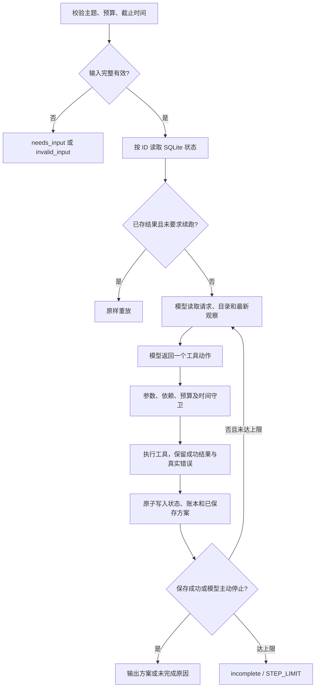

# 实现方案与取舍

## 调用流程

`agent.py` 的循环没有“超预算就改 standard”或“工具出错就重试”的自动业务分支。它只把动作交给 `BusinessTools` 执行，再把真实结果放回消息历史。真正选择档位、来源、重试或停止的接口是 `model.decide`。

`live` 使用外部模型原生 `tool_calls`，并将 `role=assistant` 的函数调用和匹配 `tool_call_id` 的 `role=tool` 返回加入下一轮上下文。每轮还提供当前权威状态，避免模型只凭早期估算行动。`offline` 的规则策略在 `OfflineModel` 中单独实现并明确标记，其目的是稳定验证工程约束。

函数调用接入参考了[阿里云官方 Function Calling 文档](https://www.alibabacloud.com/help/en/model-studio/qwen-function-calling)和[OpenAI 官方 Function Calling 文档](https://developers.openai.com/api/docs/guides/function-calling)。接口使用标准 HTTP，未引入 SDK；当前适配器只实现 Chat Completions，不宣称支持仅 Responses 接口的模型。

## 模型可以决定什么

模型可在 `search_materials`、`estimate_cost`、`generate_script`、`save_plan`、`finish` 间选择一个动作。素材检索可换来源，方案可换档位，失败可有限重试，也可停止。首选档位只是提示中的业务偏好；程序没有预先替模型生成后续动作。

`reason` 是模型提交的一句公开依据，例如“上次报价超预算，改估更轻档位”；它不是内部思维过程。Trace 记录参数、实际返回、简短依据、下一次真实调用、模型标识、响应 ID 和 token usage，不读取或持久化 `reasoning_content`。

不同观察对应的路径见下表。`qwen3.8-27b` 的真实执行已覆盖预算降级、部分成功补充来源及保存续跑，见 [真实 Trace](../examples/live/summary.json)。一次 primary 临时故障时，真实模型选择重试 primary；离线策略选择 archive。这两种实际动作均如实保留，不能写成同一条预设路径。

| 工具观察 | 后续动作 | 保留内容 |
| --- | --- | --- |
| premium=12、预算=10，rejected | 重新估算 standard=8，再生成、保存 | 拒绝报价仍在 quotes 和 Trace 中，不产生 premium 费用 |
| primary 返回 error | 选择 archive 检索 | 原失败事件和当前已有素材 |
| primary 返回一条素材与 partial | 用 archive 补足，或估算较低素材要求的档位 | primary 成功的素材 ID |
| 脚本已成功、保存失败 | 显式续跑后只再次保存 | 同一脚本 ID、素材与已发生脚本费用 |
| 所有报价不满足约束 | finish | 报价及费用/时间缺口，不保存 |

## 账本与时间

以 `standard` 为例，脚本成功后增加 `script:standard=100` 分；保存成功时增加 `production:standard=700` 分。合计 800 分＝8 SIM，其中 1 已发生、7 预留。保存失败不会增加制作预留。

每次报价计算：`已发生/已预留金额 + 尚未生成脚本的费用 + 所选制作费`。因此生成过其他档位脚本后降级，不会忽略沉没成本。测试包含先生成 premium 和 standard 脚本后尝试保存 premium 的场景：总需求升至 13，预算 12，保存被阻止。

首轮真实模型的停止说明曾把 300 分写成 300 SIM。账本不受影响，但文字解释错误。因此报价新增 `currency / total_units / budget_units / budget_gap_units`，提示明确 100 分＝1 SIM。独立复验时，模型正确表述“3 SIM，三档分别缺 9/5/1 SIM”，见 [复验 Trace](../examples/unit-clarification/live/budget_impossible/trace.md)。

脚本与保存前都重新计算当前费用和预计完成时间。早期可行报价会因额外检索、其他脚本费用或真实时间推移失效；这时工具返回 `CONSTRAINT_CHANGED`，下一步仍由模型决定。时间同时考虑真实当前时间与已累计模拟耗时，取较晚值。回归样例的业务时间冻结，实际事件时间另存。

## 状态、重复执行与续跑

SQLite `jobs` 保存完整状态、账本、成功素材与脚本、工具历史和故障计数；`plans` 的主键为任务 ID。工具结果、状态、费用和方案在同一个事务内提交。业务工具没有真实外部副作用，因而进程中断后可以从最后完整 checkpoint 恢复。

默认请求 ID 是规范化业务输入的 SHA-256 前缀。金额 `10` 和 `10.0`、表示同一时刻的不同时区时间会规范化。用户指定 ID 时，完整指纹校验可阻止不同输入误用同一 ID。相同输入显式指定不同 ID 表示新的独立业务任务。

已完成任务始终重放；未完成任务只有显式 `--resume` 才继续。续跑不会清空成功结果或重置一次故障。成功脚本按档位不可变复用，检索同源同查询可复用缓存。估算不缓存，避免旧报价绕过约束。

执行器用 300 秒 SQLite 租约阻止同一任务同时推进，每次 checkpoint 刷新；模型请求超时为 45 秒。异常退出后租约到期可续跑。它是本地演示级保护，不是分布式 Runtime，也没有对真实外部服务承诺 exactly-once。

## 状态口径

顶层状态为 `completed / incomplete / needs_input / invalid_input`，`running` 仅在执行中持久化。步骤为 `pending / blocked / partial / failed / succeeded`。一次失败后重试成功可以让该步骤当前状态变为 succeeded，原错误事件仍保留。素材来源的 partial 不会被改写；只有所选方案素材数量已满足时，聚合 materials 步骤才成功。

只有保存工具成功才置 completed。模型输出“已完成”的自然语言、无效参数、未知工具、缺依赖或超预算都不能完成任务。模型不可用直接返回 incomplete，不自动切换 Mock。

## 技术取舍与限制

选用 Python 标准库而非 Agent 框架，使 3 小时量级项目的职责边界和费用状态更容易审查；代价是协议校验、持久化和错误处理需要自行实现。没有 UI 或部署，时间投入集中于核心链路与复验。

合成工具、模板脚本、静态制作耗时都只适合演示。当前 `qwen3.8-27b` 已完成真实场景验收，但没有跨模型、跨主题大样本评估。任务状态 JSON 与消息历史会随人工多次续跑增长，尚无压缩/归档；长期无人值守和真实付费工具需要另行设计预授权、外部幂等键和恢复流程。
